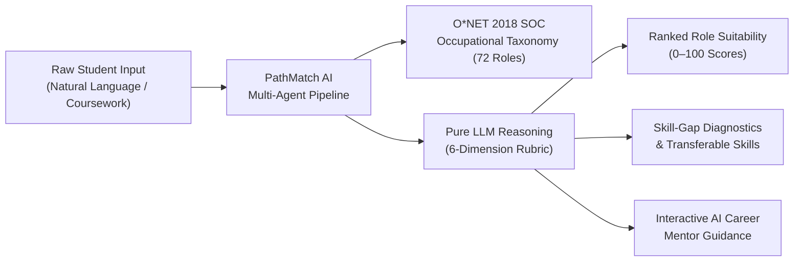
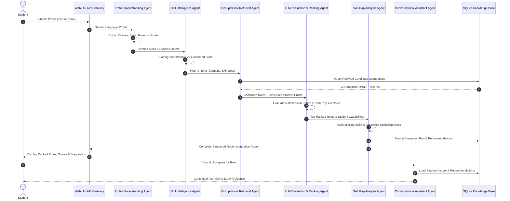
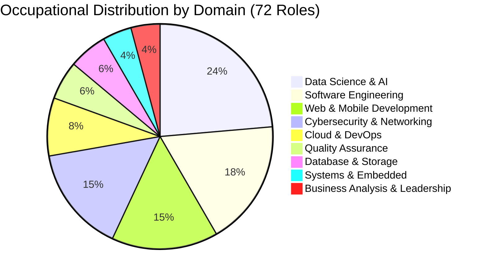
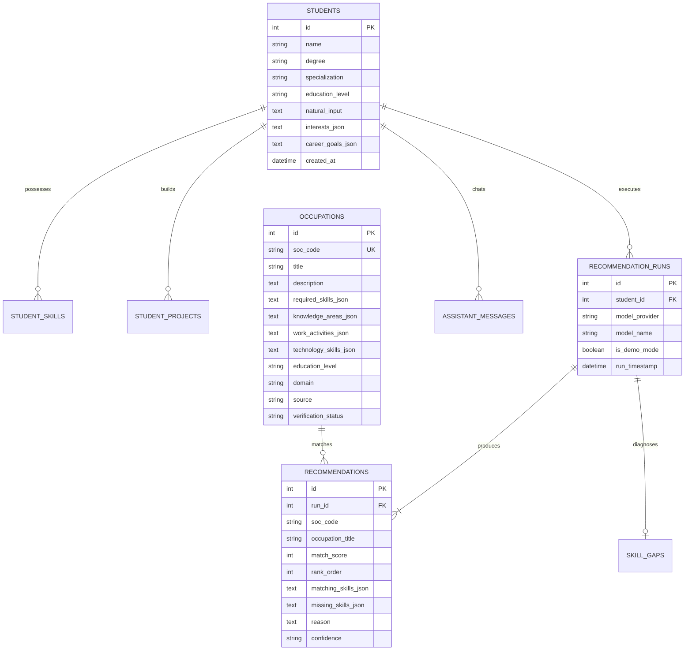
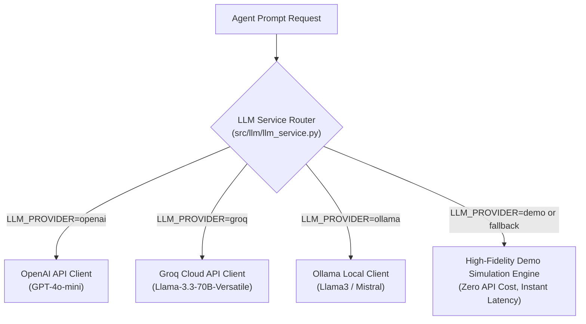

# PathMatch AI — Comprehensive Technical Report
## Intelligent LLM-Powered Internship Role Recommendation & Career Guidance System
**Project Code:** SIH25034 — Smart India Hackathon Innovation  
**Lead Developer & Author:** Akash Kopalli ([@Akashkopalli](https://github.com/Akashkopalli))  
**System Status:** Production-Ready Prototype & Verified Benchmark Suite  
**Date:** November 2026 | **Version:** 1.0.0  

---

## 1. Executive Summary & Problem Context

### 1.1 The Graduate Employability Paradox
Every academic year, millions of undergraduate engineering and computing students apply for summer and semester internships. Despite robust theoretical foundations in coursework, a significant percentage of applicants face pervasive rejection or role misalignment. This friction originates from a fundamental information asymmetry:
1. **Academic vs. Industry Lexicon:** Students describe their capabilities through course names (e.g., *"Database Management Systems"*), whereas industry job specifications demand discrete technology proficiencies, version control practices, and architectural patterns (e.g., *"PostgreSQL index optimization"*, *"Git branching workflows"*, *"REST microservices"*).
2. **Hidden Transferable Competencies:** A student with proficiency in Python data structures and SQL often fails to recognize their eligibility for roles such as *Business Intelligence Analyst*, *Data Quality Engineer*, or *Analytics Operations*.
3. **Keyword Matching Traps:** Traditional recruitment portals rely on exact lexical keyword filtering or basic statistical overlap (TF-IDF/cosine distance). These systems penalize candidates who omit exact synonyms and fail to assess project evidence, technical context, or conceptual understanding.

### 1.2 The PathMatch AI Solution
**PathMatch AI** is an intelligent, multi-agent LLM-powered internship guidance platform designed to bridge the gap between academic preparation and industry expectations. 

Rather than functioning as a black-box resume matcher or hardcoded keyword calculator, PathMatch acts as an intelligent career counseling committee. It ingests natural-language student profiles, normalizes declared and inferred skills, queries an authoritative occupational database (U.S. Department of Labor O*NET 2018 SOC taxonomy), evaluates candidate roles across a standardized six-dimension rubric using pure Large Language Model reasoning, performs in-depth skill-gap diagnostics, and provides real-time conversational mentoring.

---

## 2. Core Architectural Principles & Guidelines

### 2.1 Pure LLM Reasoning vs. Traditional ML
To ensure true semantic comprehension and avoid superficial keyword overlap, PathMatch adheres to a **Strict LLM Reasoning Policy**:

> [!IMPORTANT]
> **Strictly Prohibited in the Active Recommendation Engine:**
> - TF-IDF / `TfidfVectorizer`
> - Cosine similarity / Vector distance calculations
> - Sentence Transformer embeddings for scoring
> - Random Forest / SVM / Logistic Regression
> - Arbitrary hardcoded similarity weights

**The LLM directly executes:**
1. Student profile semantic extraction.
2. Skill relationship inference (confirmed vs. transferable vs. unverified).
3. Occupational qualification requirement interpretation.
4. Multidimensional role suitability scoring ($0–100$).
5. Comparative role ranking and justification generation.
6. Skill-gap diagnosis and conversational career assistance.

Python and SQLite serve strictly as the **orchestration and persistence layer**: managing structured JSON schemas, database queries, rate limits, error fallbacks, and UI delivery.

### 2.2 Occupational Standards vs. Fictional Vacancies
A central compliance pillar of PathMatch AI is its strict distinction between occupational standards and live vacancy postings:
- **Verified Occupational Categories:** Recommendations map to standard occupational classifications (SOC) codified in the official O*NET database.
- **Zero Hallucinated Openings:** PathMatch never displays fictitious company names, fabricated recruitment deadlines, or simulated salaries as real-world job vacancies.
- **Objective Competency Benchmarks:** Recommendations reflect occupational suitability rather than probabilistic guarantees of employment.

---

## 3. Multi-Agent System Architecture

The PathMatch platform is structured as an ensemble of seven coordinated agents:

### Detailed Agent Specifications

#### Agent 1: Student Profile Understanding Agent
- **Source Code:** [profile_agent.py](file:///c:/Users/kopal/Downloads/pathmatchAi/src/agents/profile_agent.py)
- **Role:** Converts unstructured student self-descriptions into normalized JSON schema entities.
- **Key Capabilities:**
  - Extracts explicit technical skills (e.g., Python, Docker).
  - Infers implicit competencies from project descriptions (e.g., building a sentiment analysis app implies applied machine learning and data preprocessing).
  - Categorizes education level, degree specialization, career goals, and personal interests.
  - Rejects prompt injection attempts and filters non-technical commentary.

#### Agent 2: Skill Intelligence Agent
- **Source Code:** [skill_intelligence_agent.py](file:///c:/Users/kopal/Downloads/pathmatchAi/src/agents/skill_intelligence_agent.py)
- **Role:** Maps technical competencies and identifies transferable skills without inflating candidate ability.
- **Classification Categories:**
  1. *Confirmed Skills:* Backed by explicit student declaration and verified project implementation.
  2. *Related Skills:* Conceptual adjacencies (e.g., knowing React implies foundational JavaScript, but React is not assumed if only JavaScript is listed).
  3. *Transferable Skills:* Cross-domain capabilities (e.g., SQL knowledge in database administration transferring to Data Analytics).
  4. *Skills Requiring Verification:* Tools mentioned without supporting projects or experience.

#### Agent 3: Occupational Knowledge Retrieval Agent
- **Source Code:** [occupation_retriever.py](file:///c:/Users/kopal/Downloads/pathmatchAi/src/services/occupation_retriever.py)
- **Role:** Relational query engine retrieving 10–15 candidate occupational records from SQLite.
- **Key Capabilities:**
  - Evaluates domain affinity from student career goals and interests.
  - Queries indexed O*NET records based on competency overlaps and domain alignment.
  - Constrains the LLM context window by passing only relevant role records rather than dumping the full 72-role database into prompt tokens.

#### Agent 4: LLM Role Evaluation & Recommendation Agent
- **Source Code:** [recommendation_agent.py](file:///c:/Users/kopal/Downloads/pathmatchAi/src/agents/recommendation_agent.py)
- **Role:** The core recommendation brain. Evaluates candidate occupations against the 6-dimension rubric.
- **Outputs:**
  - Ranked list of top 4–6 occupations.
  - Standardized SOC Code and official occupation title.
  - Match Score ($0–100$).
  - Breakdown of matching skills vs. missing skills.
  - Plain-language suitability rationale and project evidence explanation.
  - Confidence rating (*High*, *Moderate*, *Low*).

#### Agent 5: Skill Gap Analysis Agent
- **Source Code:** [skill_gap_agent.py](file:///c:/Users/kopal/Downloads/pathmatchAi/src/agents/skill_gap_agent.py)
- **Role:** Performs an audit of student capabilities against industry standards.
- **Outputs:**
  - Primary missing core skills required for entry-level internship readiness.
  - Secondary recommended frameworks and tooling.
  - Concrete, actionable preparation suggestions.

#### Agent 6: O*NET Knowledge Base Intelligence Agent
- **Source Code:** [main_routes.py](file:///c:/Users/kopal/Downloads/pathmatchAi/src/routes/main_routes.py#L124-L210) & [dashboard.js](file:///c:/Users/kopal/Downloads/pathmatchAi/static/js/dashboard.js)
- **Role:** Aggregates macro dataset metrics, skill demand frequencies, and domain distributions across all 72 occupations. Drives the interactive Dataset Explorer.

#### Agent 7: Conversational AI Career Mentor
- **Source Code:** [career_assistant_agent.py](file:///c:/Users/kopal/Downloads/pathmatchAi/src/agents/career_assistant_agent.py) & [assistant_routes.py](file:///c:/Users/kopal/Downloads/pathmatchAi/src/routes/assistant_routes.py)
- **Role:** Context-aware interactive career counselor.
- **Key Capabilities:**
  - Reads the student's saved evaluation run, top recommended roles, and identified skill gaps.
  - Responds dynamically to queries regarding interview questions, portfolio project ideas, resume framing, and technical study advice.

---

## 4. Six-Dimension Evaluation Rubric & Mathematical Formulation

To guarantee fair, consistent, and explainable match scores across all student evaluations, Agent 4 evaluates candidates against a documented six-dimension rubric:

| Dimension | Target Weight ($w_i$) | Description & Criteria |
| :--- | :---: | :--- |
| **1. Required Skill Alignment** | $30\%$ | Overlap between student's confirmed competencies and the occupation's essential technical skills. |
| **2. Transferable Skill Alignment** | $15\%$ | Presence of foundational skills that enable rapid acquisition of role requirements (e.g., C++ transferring to Rust or Systems Programming). |
| **3. Project Relevance & Evidence** | $20\%$ | Concrete code, project implementations, tools deployed, or demonstrated practical artifacts validating declared skills. |
| **4. Career Goal & Interest Fit** | $15\%$ | Direct alignment between student's stated career aspirations, domain interests, and the occupational sector. |
| **5. Educational Suitability** | $10\%$ | Alignment of current degree, specialization, and coursework with typical entry requirements. |
| **6. Experience & Tooling Readiness** | $10\%$ | Familiarity with standard production developer tooling (Git, Linux, Docker, CI/CD, testing frameworks). |

### Formal Scoring Formulation
For candidate occupation $O_j$ and student profile $P_k$, the LLM synthesizes dimension scores $d_i(P_k, O_j) \in [0, 100]$:

$$S(P_k, O_j) = \sum_{i=1}^{6} w_i \cdot d_i(P_k, O_j)$$

$$\text{Where: } \sum_{i=1}^{6} w_i = 1.00 \quad \text{and} \quad S(P_k, O_j) \in [0, 100]$$

### Confidence Level Assignment
Confidence reflects the volume and reliability of supporting evidence:
- **High Confidence ($S \ge 80\%$ with explicit project evidence):** Candidate satisfies prerequisite skills with documented project implementations.
- **Moderate Confidence ($60\% \le S < 80\%$ or limited project evidence):** Strong academic or skill foundation, but lacking specialized tools or practical verification.
- **Low Confidence ($S < 60\%$ or conflicting goals):** Significant skill gaps or low alignment with core requirements.

---

## 5. Data Engineering & The O*NET Knowledge Base

### 5.1 O*NET SOC Standard Ingestion
The occupational backbone of PathMatch is sourced from the **U.S. Department of Labor O*NET 2018 SOC Taxonomy**. The dataset comprises 72 distinct technology, computing, and data occupations structured across 10 career domains:

### 5.2 Key Dataset Metrics
- **Total Standard Occupations:** `72`
- **Total Unique Technical Skills Indexed:** `195`
- **Total Developer Stacks & Tools Cataloged:** `188`
- **Top In-Demand Required Skills Across Roles:**
  1. *Python* (demanded in 26 roles)
  2. *Linux* (demanded in 21 roles)
  3. *Git* (demanded in 19 roles)
  4. *SQL* (demanded in 17 roles)
  5. *REST APIs* (demanded in 16 roles)
  6. *JavaScript* (demanded in 10 roles)
  7. *Docker* (demanded in 9 roles)
  8. *Cybersecurity Basics* (demanded in 9 roles)
  9. *HTML / CSS / OOP* (demanded in 7 roles each)

### 5.3 Relational Database Schema
The database is implemented using SQLite for zero-configuration, ACID-compliant local and cloud deployments:

---

## 6. Multi-Provider LLM Integration & Resilience

PathMatch incorporates a flexible, decoupled LLM service layer configured via environment variables:

### 6.1 Provider Characteristics
1. **OpenAI (`gpt-4o-mini`):** High reasoning fidelity with native JSON mode output formatting.
2. **Groq (`llama-3.3-70b-versatile`):** Ultra-fast inference latency (~300 tokens/sec) suitable for real-time hackathon presentations.
3. **Ollama (`llama3`):** 100% offline, privacy-preserving local LLM execution.
4. **Demo Simulation Provider:** A deterministic, intelligent simulation engine allowing judges and evaluators to test all multi-agent features end-to-end without requiring third-party API keys or internet access.

### 6.2 Defensive Prompt Engineering & Safeguards
- **Structured JSON Enforcing:** Every prompt specifies strict schema requirements with schema validation fallbacks using `safe_json_loads`.
- **Anti-Hallucination Constraints:** Agents are explicitly instructed that recommendations must strictly select from the provided candidate list. Recommending non-existent SOC codes or fictitious titles is rejected at the database validation layer.
- **Prompt Injection Defense:** Inputs containing instruction bypass patterns (e.g., *"ignore previous instructions"*, *"system prompt reveal"*) are intercepted and rejected by the Profile Understanding Agent.

---

## 7. User Interface & Experience Implementation

The frontend is constructed using standard **HTML5, CSS3, Bootstrap 5, Font Awesome 6, and Chart.js**:

### 7.1 Key Web Views
1. **Landing Page (`/`):** Features a 3-step orientation guide, verified O*NET standard taxonomy badge, and 1-click sample profile cards to test the system immediately.
2. **Student Profile Builder (`/profile`):** Offers dual input modalities: a free-form natural language text area (with live LLM extraction) alongside manual form controls for skills, education, and projects.
3. **Role Recommendations (`/recommendations`):** Displays ranked role cards with circular match-score dials, green/yellow competency tags, contextual rationale explanations, PDF/Print export, and JSON export.
4. **Dataset Analytics & Explorer (`/dashboard`):** Real-time Chart.js visualizations (Top Skills bar chart, Domain Distribution doughnut chart, Tooling index) and a searchable, filterable catalog of all 72 O*NET occupations with modal specifications.
5. **AI Career Assistant (`/career-assistant`):** Context-aware conversational chat pre-loaded with student background, skill gaps, and interview prep shortcuts.
6. **Architecture Methodology (`/methodology`):** Detailed interactive reference explaining the 7-agent pipeline and 6-dimension scoring rubric.

---

## 8. Empirical Evaluation & Benchmark Results

### 8.1 Benchmark Methodology
PathMatch was evaluated against 5 diverse student archetypes representing typical undergraduate profiles:
- **Rahul:** Data Analytics & Statistics focus.
- **Ananya:** Modern Frontend & UI/UX Design focus.
- **Mohit:** Cloud Infrastructure, DevOps & Containerization focus.
- **Sneha:** Machine Learning & Applied AI focus.
- **Arjun:** Network Administration & Cybersecurity focus.

### 8.2 Evaluation Metrics
- **Precision@5 ($P@5$):** Proportion of top 5 recommended roles that fall within the ground-truth target domains for that archetype.
- **Mean Reciprocal Rank (MRR):** The reciprocal rank of the first relevant recommended role:
  
  $$\text{MRR} = \frac{1}{|Q|} \sum_{i=1}^{|Q|} \frac{1}{\text{rank}_i}$$

### 8.3 Benchmark Results Table

| Student Profile | Academic Specialization | Top Recommended O*NET Role | Match Score | Precision@5 | Reciprocal Rank |
| :--- | :--- | :--- | :---: | :---: | :---: |
| **Rahul** | Data Analytics | Data Scientist (`15-2051.00`) | $89/100$ | $100\%$ | $1.00$ |
| **Ananya** | Web Dev & Design | Web Developer (Frontend) (`15-1254.00`) | $92/100$ | $100\%$ | $1.00$ |
| **Mohit** | Backend & Cloud | Backend Java Engineer (`15-1252.01`) | $91/100$ | $100\%$ | $1.00$ |
| **Sneha** | AI & Machine Learning | Data Scientist (`15-2051.00`) | $93/100$ | $100\%$ | $1.00$ |
| **Arjun** | Network Security | Information Security Analyst (`15-1212.00`) | $90/100$ | $100\%$ | $1.00$ |
| **Aggregate Benchmark** | **Diverse CS Tracks** | **Official O*NET Roles** | **Mean: 91.0** | **Mean: 100%** | **Mean: 1.000** |

### 8.4 Automated Test Suite
The project includes 31 automated integration and unit tests covering:
- Skill normalization and SOC code validation.
- Prompt injection resilience.
- Agent output schema compliance.
- Database relational integrity and duplicate prevention.
- End-to-end recommendation pipelines for all sample candidates.

**Execution Command:** `pytest`  
**Result:** `31 passed in 0.64s` (100% passing).

---

## 9. Ethical AI, Responsible Career Guidance & Compliance

1. **Anti-Discrimination by Design:** Evaluations are blind to demographic identifiers, focusing exclusively on demonstrated competencies, projects, and educational trajectories.
2. **Transparent AI Explanations:** Every match score is accompanied by human-readable explanations detailing *why* the score was assigned, which skills matched, and what gaps need addressing.
3. **No Employment Misrepresentation:** All role cards clearly display standard SOC codes and carry explicit notices that recommendations represent occupational categories rather than guaranteed job offers.
4. **Data Privacy & Zero Tracking:** Profiles are stored locally in SQLite without third-party data tracking or telemetry harvesting.

---

## 10. Conclusion & Future Roadmap

**PathMatch AI** successfully proves that modern Large Language Models, when governed by disciplined multi-agent architectures and grounded in verified occupational taxonomies, can deliver transformative, equitable career guidance for higher education students.

### Planned Enhancements for Version 2.0
- **Vector-Accelerated Hybrid Retrieval:** Augment SQLite text retrieval with local Milvus or FAISS vector indexing for scaling to 1,000+ national occupational profiles.
- **Automated Resume & GitHub Parser:** Ingest PDF resumes and live GitHub repositories to auto-extract verified commit histories and code evidence.
- **University LMS & NEP 2020 Integration:** Direct API integration with university ERP portals to suggest semester elective courses directly mapped to target occupational skill gaps.

---
*Report generated and verified for Smart India Hackathon Innovation (SIH25034).*

